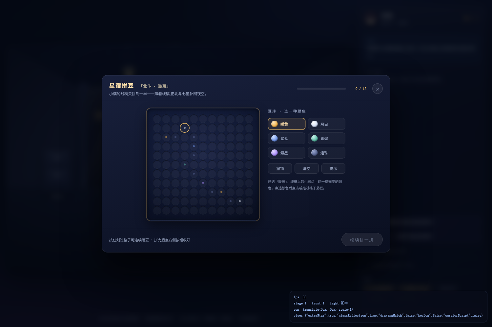
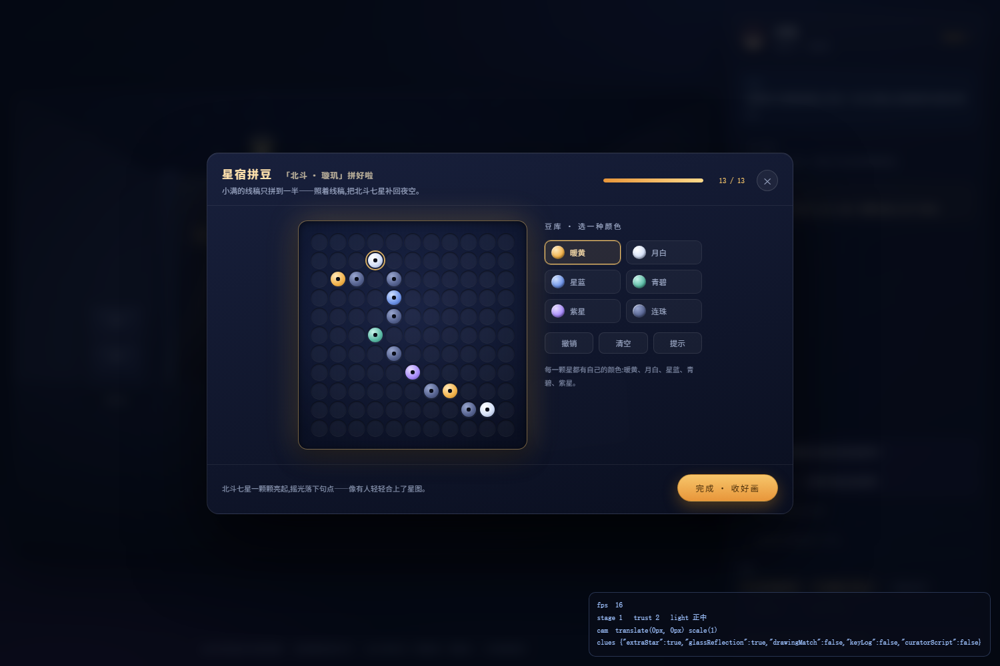
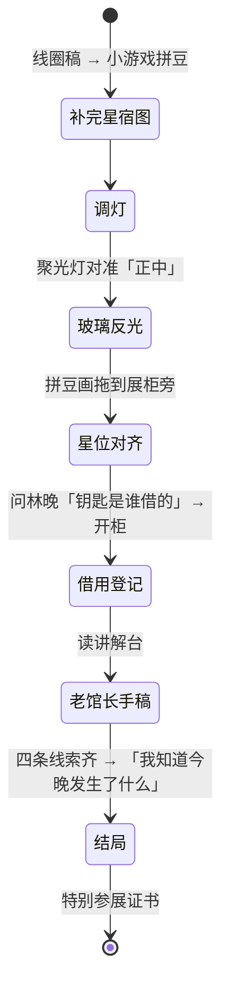
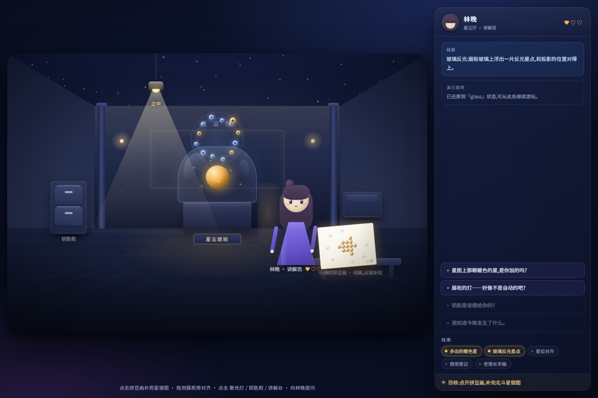
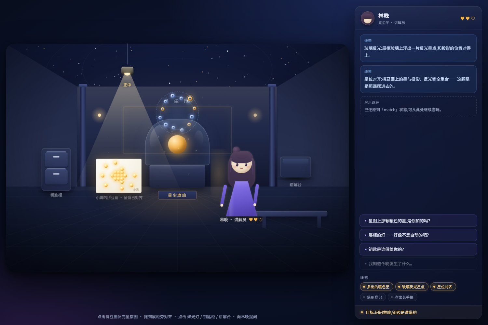
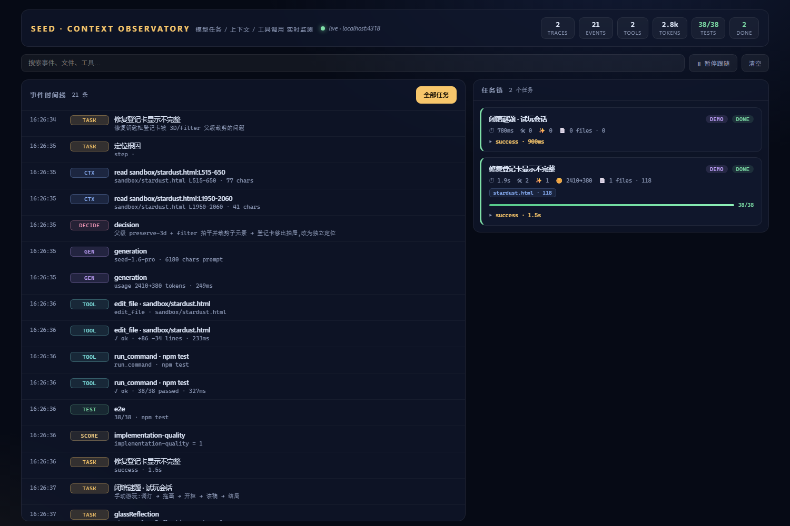

# 星尘琥珀 · 闭馆谜题

一个**单文件、零运行时依赖**的互动叙事解谜（`stardust.html`，约 124KB / 3585 行，纯手写 DOM + CSS + 原生 JS），内含一个**星宿拼豆小游戏**，外加一个独立进程的 **AI 任务观测面板**（`observer/`，零依赖 Node）。

场景：自然博物馆闭馆后的「星尘厅」。讲解员林晚似乎在等谁——补完一幅没拼完的拼豆画、调好一盏灯、借出一把钥匙、读完一页没有写完的讲解稿，你会找到那颗不该出现在星图上的星。

> 这个作品面向「视觉能力 × coding 长上下文」的考察：不仅交付画面，还交付**截图驱动的迭代证据链**（见 [DEVNOTES.md](./DEVNOTES.md)）与**可回归的 E2E 测试**。


## 快速开始

- 直接双击 `stardust.html`（file:// 即可运行）
- 或 `python -m http.server` 后访问

### URL 参数（演示/评审用）

| 参数 | 作用 |
| --- | --- |
| `?demo=1` | 演示模式：约 22 秒自动巡演完整故事线（含自动拼豆，真实交互驱动，非剪辑） |
| `?stage=glass` | 直达：灯光已对准，玻璃反光已现 |
| `?stage=match` | 直达：星宿已拼好并拖至展柜对齐，20 颗豆子点亮 |
| `?stage=script` | 直达：钥匙柜已开、讲解稿已展开 |
| `?stage=ending` | 直达：结局证书 |
| `?play=1` | 跳过启动封面，直接进入 |
| `?debug=1` | 调试 HUD（FPS / 状态实时面板）+ 挂载 `window.__STARDUST__` |

> 状态跳转复用真实的迁移链——不偷写状态，与玩家操作走同一套 `transitions`/`grantClue`。

## 星宿拼豆小游戏

场景里的拼豆画是**线稿半成品**：小满只拼好了最亮的那颗暖星。点击画作打开工作台——

- **豆库选色**：暖黄 / 月白 / 星蓝 / 青碧 / 紫星 / 连珠 六色，对应北斗七星的星色与连线
- **对照落豆**：11×11 板上，线稿小圆点提示每格需要的颜色；点选颜色后点击或按住划过格子连续落豆
- **趣味反馈**：错色豆标红抖一下且不计进度；撤销 / 清空 / 提示（提示会自动帮你选好颜色并指出星名，如「天璇 · 需要月白」）
- **键盘可玩**：方向键移动光标、回车落豆、Esc 退出
- **完成时刻**：13 颗豆子按顺序弹亮，北斗七星在板上升起，信任值 +1；收好画后回到展厅，把拼好的画拖到展柜旁继续主线

| 拼豆工作台 | 拼完的星宿 |
| --- | --- |
|  |  |

## 叙事与状态机

线索不是清单，而是一条因果链——每一环都以上一环为条件：



状态是单一数据源 `S`（关卡阶段、信任值、灯角度、线索表），`render()` 是唯一渲染入口；对话按线索进度动态改写（同一问题在 0/2/4 条线索时回答不同）。

## 视觉设计要点

- **手绘式场景**：960×640 设计稿等比缩放，全部元素为 CSS 绘制（展柜玻璃、拼豆、人物、地板透视线），零图片资源
- **摄像机层**：开场推镜、开柜/读稿微推、结局缓拉（`#scene` + `applyCam`）
- **气质细节**：体积光尘、道具接触阴影、人物轮廓光、鼠标四层视差
- **两个展开动画**：抽屉 3D 拉出 + 借用登记卡抽出展开；讲解稿铰链翻起 + 横线逐行浮现
- **最后的见证时刻**：星位对齐时 20 颗拼豆逐颗点亮为琥珀色光源
- **降级**：`prefers-reduced-motion` 下禁用镜头/视差/光尘动画

| 反光线索 | 星位对齐 |
| --- | --- |
|  |  |

## 工程与长上下文

- 3585 行单文件，结构分区：叙事脚本 / 状态迁移 / 渲染 / 交互 / 镜头 / 拼豆小游戏 / 构建器 / 调试
- **叙事数据表**：所有台词、旁白、提示集中在 `SCRIPT` 对象里，逻辑层只引用键名；同一问题按线索进度返回不同回答，文案与逻辑彻底解耦
- **状态迁移白名单**：所有状态变更经由 `transitions`（`nextLight` / `grantClue` / `toggleCabinet` / `enterEnding` …），线索的连带效果（阶段推进、信任值）集中声明在 `CLUE_EFFECTS` 表——因果链从散落赋值收敛为一张表
- **小游戏独立状态**：豆库/板面/撤销栈与叙事状态分离，只有「拼完」这一个事实进入状态机（`S.perlerBuilt`），小游戏可反复进出不污染主线
- **调试 API**：`?debug=1` 下挂载 `window.__STARDUST__`（`state` / `transition` / `grantClue` / `jump` / `ending` / `reset` / `studio.solve`）+ FPS/状态 HUD；E2E 用它做状态级断言
- **体检**：标签页隐藏自动暂停动画、`contain: layout style paint` 限制重排范围、四核以下设备自动降低星点/尘埃数量
- 无障碍：全场景键盘可达（Enter/Space）、拼豆板方向键操作、`aria-live` 对话播报、证书 `inert`、焦点环、减少动效
- E2E 用无头 Chrome 驱动真实鼠标/键盘/拖拽，45 条断言覆盖封面、拼豆小游戏（选色/错色/撤销/提示/完成）、因果链、镜头、键盘、演示模式、降级、调试 API

### 调试示例

```js
// 控制台 ?debug=1
__STARDUST__.state;                // 只读状态快照
__STARDUST__.jump('match');        // 复现关键状态(走真实迁移链)
__STARDUST__.transition('nextLight');
__STARDUST__.grantClue('keyLog');
__STARDUST__.studio.open();        // 打开星宿拼豆小游戏
__STARDUST__.studio.solve();       // 一键拼完(演示用)
__STARDUST__.reset();
```

### 测试

```bash
npm install        # 仅安装 puppeteer-core（不下载浏览器）
npm test           # 45 条 E2E 断言，约 75s
npm run capture    # 重新生成 docs/screens/ 关键帧截图
```

自动探测本机 Chrome/Edge；其他环境用 `CHROME_PATH` 指定。

## AI 可观测性（Seed · Context Observatory）

`observer/` 是一个**独立进程**，实时接收「模型任务事件」，聚合成任务链并在面板上直播：接到了什么任务、读了哪些文件片段（行号+字符数）、调了哪些工具、生成了多少 token、测试跑得怎样。



```powershell
cd observer
npm start                  # 面板 http://localhost:4318
npm run demo               # 另开终端:播放任务事件流(约 30s)
# 让真实游戏也上报:打开 stardust.html?observe=1
```

- 数据模型与 Langfuse 对齐（trace / generation / span / score），配置 `LANGFUSE_*` 环境变量即可转发；未配置时纯本地、零依赖
- 默认脱敏：上下文只存 **字符数 + sha256 + 120 字预览**，`STORE_RAW_CONTEXT=1` 才保留原文
- 游戏侧上报走 `?observe=1`，CORS + keepalive，失败静默不阻塞
- Agent 侧接入用 `observer/sdk.mjs`：`createTracer().task()` 一行接入，观测失败绝不影响业务
- 自测：`cd observer && npm test`（20 断言：入库/脱敏/聚合/SSE/面板/Langfuse 映射/SDK 接入与异常链路）
- 真实模型联调：`ARK_API_KEY=... node demo.mjs --live`（火山方舟，可选）

## 目录

```
stardust.html        游戏本体（单文件，无依赖，含拼豆小游戏）
observer/            独立观测进程：实时面板 + Langfuse 兼容导出
tests/e2e.mjs        E2E 回归（45 断言）
tests/capture.mjs    关键帧截图工具（docs/screens/）
tests/browser.mjs    浏览器启动器（自动探测路径）
docs/screens/        评审用截图
DEVNOTES.md          迭代日志：反馈 → 修复 → 截图验证 的完整闭环
```
